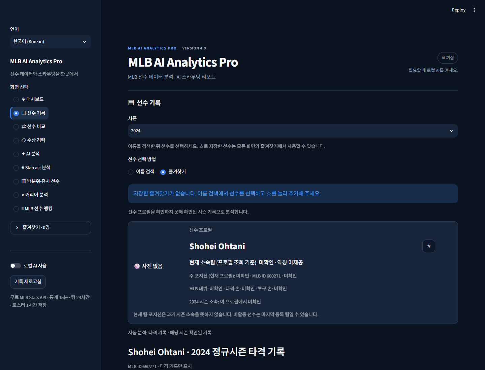

# MLB AI Analytics Pro · 4.9 Final

MLB 선수의 기록을 검색하고 비교하는 한국어·영어 Streamlit 개인 프로젝트입니다. 공식 통계 조회, 야구 통계 계산, 인터랙티브 차트와 선택적인 로컬 AI 설명을 한 앱으로 구성했습니다. **4.9가 최종 버전**이며, 공개 배포나 GitHub 업로드는 수행하지 않았습니다.

[포트폴리오 요약](PROJECT_SUMMARY.md) · [최종 인수인계](docs/FINAL_HANDOVER.ko.md) · [테스트](docs/TESTING.md) · [변경 기록](CHANGELOG.md)

## 주요 기능

- 선수 이름 검색·자동완성, 시즌별 팀/포지션 필터, 즐겨찾기
- 타격·투구·겸업 선수 기록과 두 선수 비교
- ISO·BABIP·BB%·K%·wOBA·FIP 등 고급 지표, 시즌별 리그 평균
- Statcast 타구/투구 분석, 출처 발표 백분위와 앱 계산 백분위
- 통계 프로필 기반 유사 선수, 커리어 추세와 수상 이력
- MLB 리더보드, 맞춤 필터·프리셋·CSV 내보내기
- SQLite 영구 캐시, 조회 시각/출처 표시, 선택적 시스템 진단
- Ollama 로컬 AI 보고서/질문, 한국어·영어 전환, 다크 네이비 UI

없는 값은 N/A로 표시합니다. 공식 발표값과 앱 계산값을 구분하며, 미래 성적 예측은 제공하지 않습니다.

## 실행 화면



현재 4.9 코드에서 저장된 2024년 통계 예제로 촬영한 QA 화면입니다. 실시간 조회 화면이 아니며 프로필·부가 자료는 오프라인으로 두었습니다. [390px 모바일 폭 화면](docs/images/v49-player-390.png)도 확인할 수 있습니다.

## 기술 구성

Python · Streamlit · Plotly · requests · NumPy · pandas · SQLite · Pillow · streamlit-searchbox · 선택적 Ollama. MLB Stats API와 Baseball Savant CSV를 사용합니다. pytest/pytest-cov, Ruff, Playwright는 개발 검증용입니다. pybaseball은 현재 코드의 의존성이 아닙니다.

로컬 검증 환경은 Windows/Python 3.10.4입니다. CI는 Ubuntu/Python 3.11로 설정했으며 원격 CI의 실제 실행은 아직 확인하지 않았습니다.

## 설치와 실행 (Windows)

프로젝트 폴더에서 PowerShell을 엽니다. Python이 설치되어 있어야 합니다.

```powershell
py -m venv .venv
.\.venv\Scripts\python.exe -m pip install -r requirements.txt
.\start.bat
```

`start.bat`을 더블클릭해도 됩니다. 기본 .venv를 사용하고 실행할 수 없으면 기존 .venv-test를 확인합니다. 창을 닫으면 서버가 종료됩니다. 기존 가상환경이 정상이라면 다시 만들 필요가 없습니다.

수동 실행:

```powershell
.\.venv\Scripts\python.exe -m streamlit run app.py
```

다른 환경을 사용할 때는 실행 파일 경로만 바꾸세요. 기본 모드는 LOCAL입니다. MLB/Statcast 조회에는 인터넷이 필요합니다. 앱이 요금을 청구하는 서비스나 API 키는 사용하지 않습니다.

## Ollama 설정 (선택)

Ollama를 설치·실행하고 사용할 모델을 직접 준비합니다. 예:

```powershell
ollama pull qwen2.5:1.5b
```

앱에서 **로컬 AI 사용 → 모델 목록 새로고침 → 모델 선택**을 진행합니다. 자료 준비 후 생성 버튼이나 질문을 보낼 때만 추론합니다. 연결 주소는 `http://localhost:11434`이며 인터넷에 이 포트를 노출하지 마세요. Ollama가 없어도 통계 기능은 사용할 수 있습니다. AI 설명은 실제 통계와 대조해야 합니다.

## 테스트

```powershell
.\.venv\Scripts\python.exe -m pip install -r requirements-dev.txt
.\.venv\Scripts\python.exe -m pytest -q
.\.venv\Scripts\python.exe -m pip check
.\.venv\Scripts\python.exe -m scripts.check_launcher
```

일반 테스트는 임시 저장소와 모킹을 사용합니다. **개인 데이터 격리 장치가 적용되는 pytest 실행을 사용하세요.** unittest를 직접 실행하면 conftest.py의 보호 장치가 적용되지 않습니다. 실제 API·Ollama 연결 및 브라우저 검사는 별도이며 [테스트 안내](docs/TESTING.md)를 참고하세요.

## 폴더와 개인 데이터

```text
app.py                 실행 진입점
components/            화면·차트·테마
services/              외부 조회·응답 검증·캐시·Ollama
analytics/             통계·집계·백분위·유사도
utils/                 설정·번역·즐겨찾기·프리셋
translations/          한국어·영어 사전
tests/                 오프라인 회귀 테스트·고정 예제
scripts/               수동 API·기동·브라우저·성능 검사
docs/                  인수인계·구조·보안·검증 근거
.streamlit/            다크 테마 설정
.github/workflows/     테스트 CI (배포 단계 없음)
```

LOCAL 즐겨찾기는 `data/favorites.json`, 언어 설정은 `data/settings.json`, 프리셋은 `data/leaderboard_presets.json`입니다. Windows 기본 DB는 `%LOCALAPPDATA%\MLB-AI-Analytics\mlb_analytics.db`입니다. `MLB_ANALYTICS_DATA_DIR`/`MLB_ANALYTICS_DB_PATH`를 설정했다면 해당 경로가 우선합니다. 기존 파일을 초기화하거나 이관하지 않았습니다.

환경변수 안내는 [.env.example](.env.example)에 있습니다. .env 파일은 자동으로 읽지 않습니다. CLOUD 모드에서는 개인 설정을 세션에만 보관하고 SQLite·로컬 Ollama를 차단합니다. [배포 제한](docs/DEPLOYMENT.md)을 확인하세요.

## 출처와 한계

- [MLB Stats API](https://statsapi.mlb.com/api/v1/): 선수·팀·정규시즌·수상 자료
- [Baseball Savant CSV 문서](https://baseballsavant.mlb.com/csv-docs): Statcast·리더보드·백분위
- [FanGraphs 상수 표](https://www.fangraphs.com/tools/guts?type=cn): wOBA/FIP 시즌 상수

OPS+·ERA+·wRC+는 검증된 보정 자료가 없어 N/A입니다. wOBA/FIP는 코드에 검토된 2020–2025년 상수가 있을 때만 계산합니다. Statcast는 2015년 이후를 지원하며 추적 누락/시대별 정의 차이가 있습니다. 팀 필터를 적용한 리더보드 성적은 해당 팀 재적분만이 아닌 전체 정규시즌 합계입니다.

작은 표본, 진행 중인 시즌, 공급원 장애에 따라 해석과 조회가 제한됩니다. 유사도는 실력 순위나 미래 예측 확률이 아닙니다. CLOUD는 영구 계정 저장소가 아닙니다. 데이터·사진·CSV의 공개 재배포 조건과 코드 라이선스는 확정하지 않았습니다. 외부 제공 자료의 권리는 각 권리자에게 있습니다.

## 백업·복구와 최종 상태

개인 데이터 백업은 앱을 종료한 뒤 data 폴더를 별도 위치에 복사하세요. DB는 시스템 진단 화면의 검증된 SQLite 백업을 사용하세요. 복원은 앱을 종료하고 현재 원본을 별도 보관한 뒤 진행합니다. [상세 복구 절차](docs/FINAL_HANDOVER.ko.md)를 따르세요.

최종 검사 결과와 남은 제한은 [최종 인수인계](docs/FINAL_HANDOVER.ko.md), 전체 출시 판정은 [준비도](docs/RELEASE_READINESS.md)에 있습니다. 태그 `v4.9.0`은 승인 전까지 만들지 않습니다. 자동 push·공개 저장소 생성·배포는 하지 않습니다.
